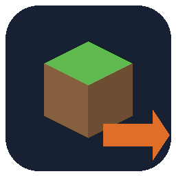
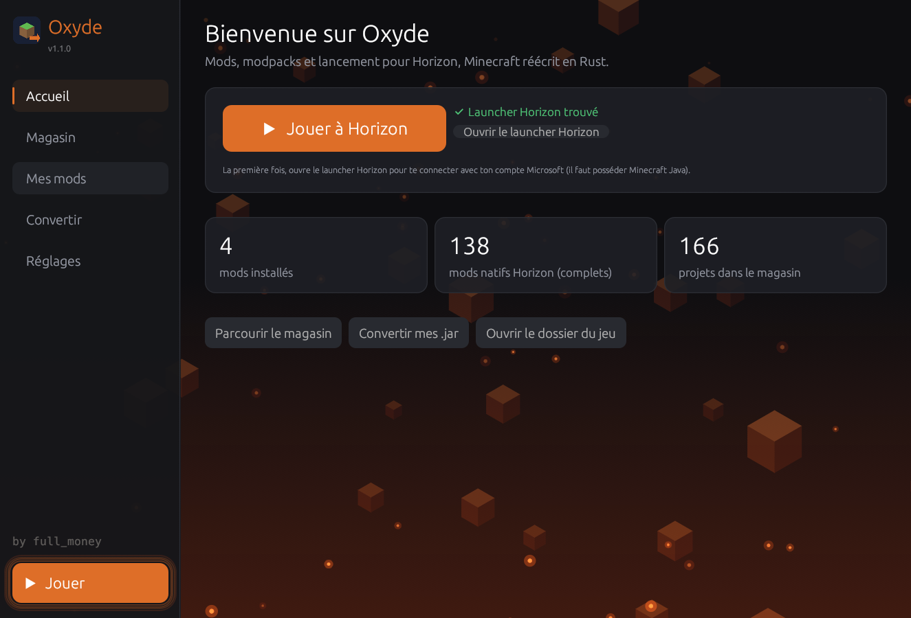
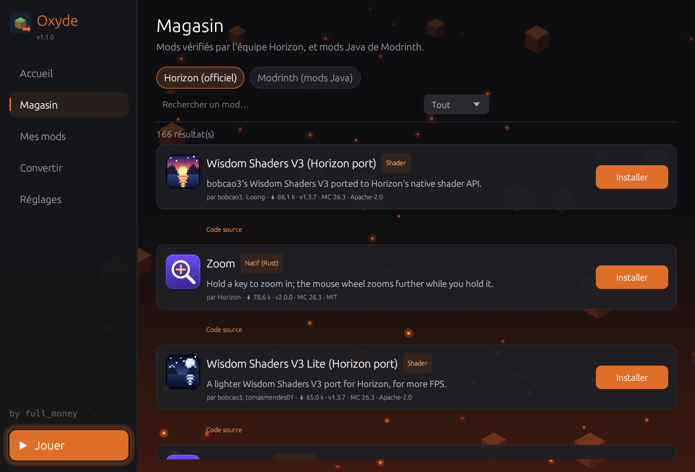
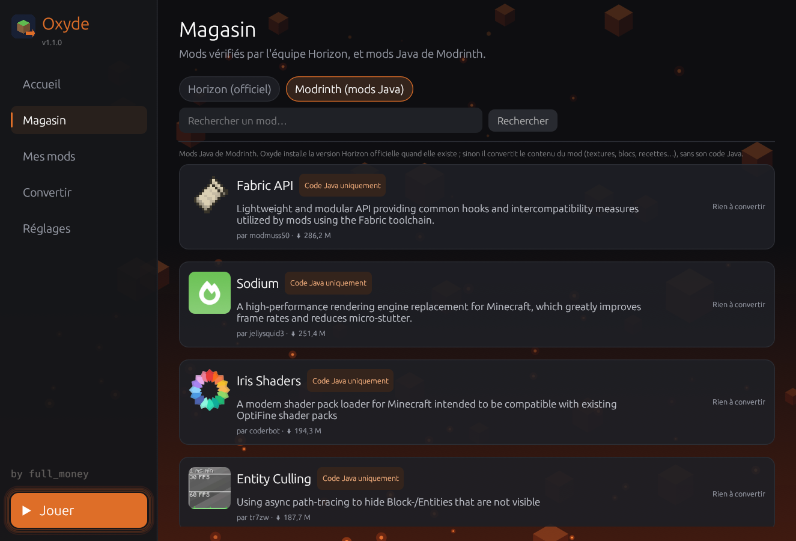
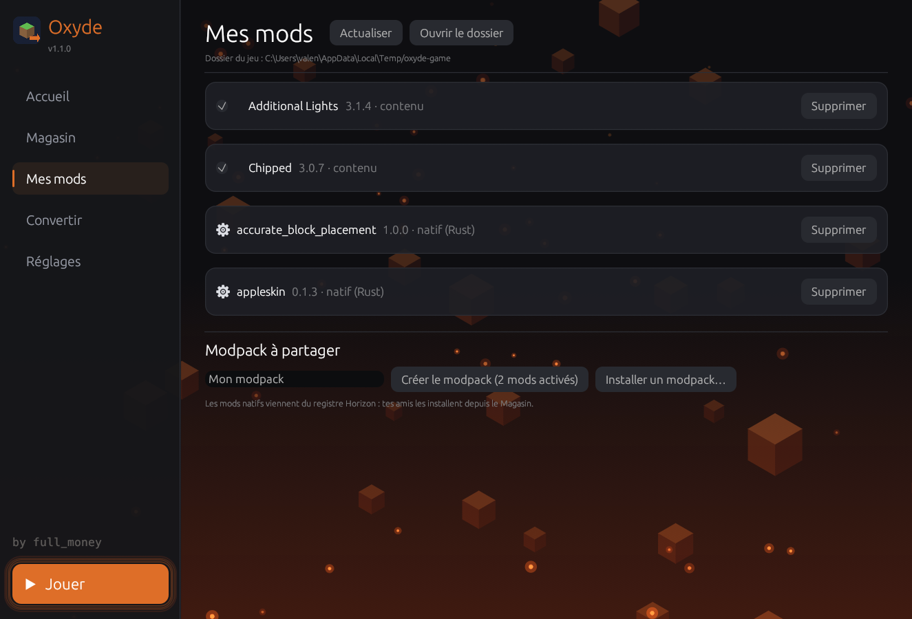
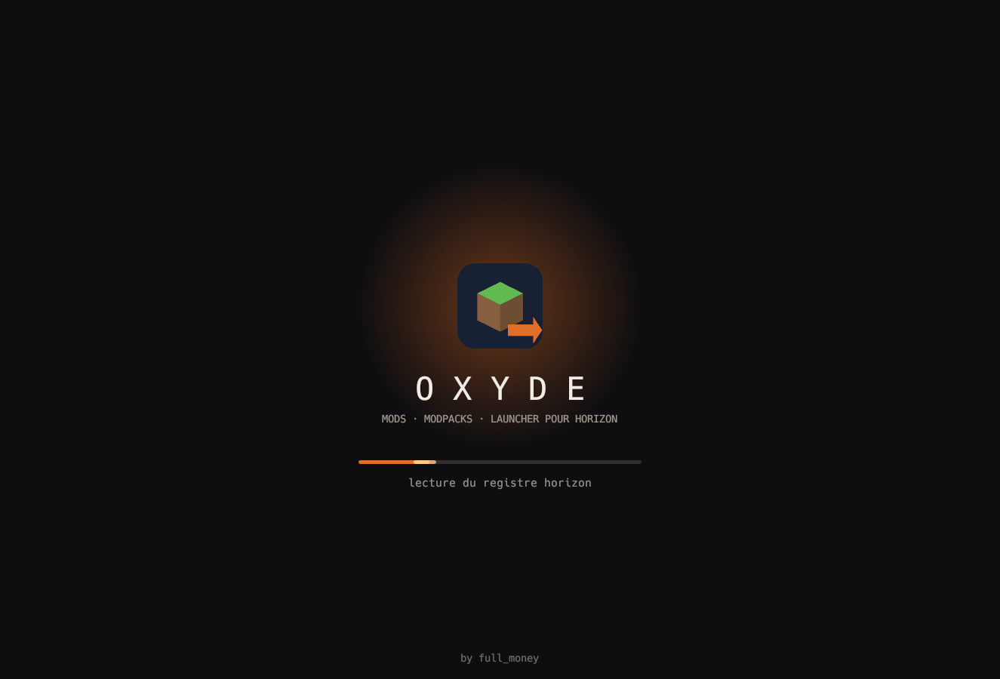

<p align="center">
  
</p>

<h1 align="center">Oxyde</h1>

<p align="center">
  <b>Mod store, Java mod converter and launcher for <a href="https://playhorizon.dev/">Horizon</a></b><br>
  Horizon is Minecraft: Java Edition 26.3 rewritten in Rust (Minecraft Rust Edition).<br>
  Free · Open source (MIT) · One <code>.exe</code> · No install · by <b>full_money</b>
</p>

<p align="center">
  <a href="../../releases/latest"><b>⬇ Download Oxyde.exe</b></a>
</p>



## Features

- **Play**: launches Horizon straight from Oxyde, through the official Horizon launcher.
- **Store**: browse the 160+ projects of Horizon's official registry (content mods, native Rust mods,
  resource packs, shaders) and install them in one click. Every file is checked against the registry
  (size and SHA-256) before it reaches your game folder.
- **Modrinth**: search Java mods on Modrinth. If Horizon already has an official version of the mod,
  Oxyde installs that one (complete, code included). Otherwise it converts the mod's content.
- **Converter**: drop your Java mods (`.jar`, Fabric / Quilt / Forge / NeoForge) or a whole `mods` folder.
- **My mods**: turn mods on and off, remove them, see what is installed.
- **Modpacks**: bundle your mods into a `.hzmods` file and send it to your friends. They drop it in Oxyde
  and click Install.
- **Auto-update**: Oxyde checks its GitHub releases at start-up and updates itself in one click,
  after checking the SHA-256 of the new version.

| Store (Horizon) | Store (Modrinth) |
|---|---|
|  |  |

| My mods | Start-up |
|---|---|
|  |  |

## How to use

1. Install [Horizon](https://playhorizon.dev/docs/install) and open its launcher once to sign in with your
   Microsoft account (you need to own Minecraft: Java Edition).
2. Download `Oxyde.exe` from [Releases](../../releases/latest) and run it.
3. Go to **Store**, pick mods, click **Install**.
4. Click **Play**.

Oxyde finds Horizon by itself: the game folder is `%APPDATA%\horizon` (or `HORIZON_HOME`) and the launcher is
`%LOCALAPPDATA%\Programs\Horizon Launcher\horizon-launcher.exe`. You can change the game folder in **Settings**.

## What a converted Java mod can and cannot do

Horizon is a new program written in Rust. It **cannot run the Java code** of Forge, NeoForge, Fabric or Quilt
mods, and neither can any converter: that code patches Minecraft's Java classes, which Horizon does not have
([Horizon docs](https://playhorizon.dev/docs/mods)). This is why Oxyde works in this order:

1. **Official Horizon version first.** Many popular mods have been rewritten in Rust for Horizon
   (AppleSkin, AE2, Zoom, minimaps…). Those are complete, code included, and Oxyde installs them from
   Horizon's registry.
2. **Otherwise, content conversion.** Oxyde keeps everything that is not code and builds a Horizon content mod
   (`.hmod`):

| Converted ✔ | Not converted ✖ |
|---|---|
| Textures, models, sounds, languages | Java code (machines, custom screens, mob AI, events) |
| Recipes, tags, loot tables, advancements | Mixins |
| Structures, features, biome modifiers | Files that replace vanilla ones |
| Blocks and items (declared from a vanilla template guessed from the name) | |

Decoration, ore, food and structure mods work best. Tech mods only keep their look and recipes.
Mods that are code only (Sodium, Fabric API, Iris…) are marked "Java code only" in the store.

3. **Later: the Java bridge.** The Horizon team plans an optional Java bridge that will run unchanged
   Fabric 26.3 jars ([plan](https://github.com/horizon-rust/horizon/issues/13914)). It is not released yet.
   Oxyde will support it when it ships.

### Conversion details

- writes `horizon-mod.toml` (API 0.2, capability `registries`, `side = "both"`);
- renames pre-1.21 folders (`recipes/`, `loot_tables/`, `tags/blocks/`…) to the 26.3 names;
- keeps files only in the mod's own namespaces, plus tag additions (`minecraft`, `c`) and vanilla atlases,
  as Horizon requires; every skipped file is listed with the reason;
- adds missing item model definitions (`assets/<id>/items/*.json`);
- declares blocks and items in `data/<id>/horizon/{block,item}/` from a vanilla template
  (`_stairs` → stairs, `_ore` → ore, `_sword` → sword…). This can be turned off in **Settings**.

## The `.hzmods` modpack format

A zip holding `pack.json` (name, version, list of mods with their SHA-256) and `mods/<id>.hmod`.
Horizon's own `.hpack` format downloads its mods from the registry, so it cannot hold mods converted on your
machine. You can also open a `.hzmods` as a zip and copy `mods/*.hmod` into the game's `horizon-mods/` folder.

## Security

- The `.exe` is **built by GitHub Actions** from this source code ([workflow](.github/workflows/release.yml)),
  never on a personal computer.
- Each release publishes the **SHA-256** of the exe and a GitHub **build provenance attestation**. To check it:
  `gh attestation verify Oxyde.exe --repo 0full-money0/oxyde`
- No exe packer (UPX), no installer, no admin rights, no telemetry.
- Auto-update only downloads from this repository's releases and checks the SHA-256 before replacing the exe.
- Store downloads only come from Horizon's registry (`github.com/.../releases/download/...`) and Modrinth's CDN,
  and are checked by hash.

Windows SmartScreen may show "Windows protected your PC" for a new unsigned exe: click
**More info → Run anyway**. Releases will be signed as soon as the project is accepted by SignPath Foundation.

### Code signing policy

Free code signing provided by [SignPath.io](https://about.signpath.io/), certificate by
[SignPath Foundation](https://signpath.org/).

- Committers and reviewers: the members of this repository with write access.
- Approvers: the repository owner (full_money).
- Only binaries built by this repository's GitHub Actions workflow from its public source are signed.
- Privacy: this program does not transfer any information to other networked systems unless specifically
  requested by the user. The only automatic requests are the update check (this repository's latest GitHub
  release) and the Horizon registry index; Modrinth is contacted only when you open its tab. No personal data
  is sent.

Enabling signing (maintainers), once SignPath has accepted the project:

1. In SignPath, create the project, a signing policy and a "GitHub.com" trusted build system linked to this repository.
2. In GitHub, **Settings → Secrets and variables → Actions**: add the secret `SIGNPATH_API_TOKEN` and the variables
   `SIGNPATH_ORGANIZATION_ID`, `SIGNPATH_PROJECT_SLUG`, `SIGNPATH_POLICY_SLUG`.
3. The next release is signed. The workflow refuses to publish if the signature is not valid.

## Command line

```bash
Oxyde.exe --convert <output-folder> mod1.jar mod2.jar
Oxyde.exe --install horizon <project-id> <game-folder>
Oxyde.exe --install modrinth <slug> <game-folder>
```

## Build from source

```bash
cargo build --release
```

## Releasing a new version (maintainers)

1. Bump `version` in `Cargo.toml` (for example `1.1.1`) and commit.
2. `git tag v1.1.1 && git push origin main --tags`
3. GitHub builds and publishes the release. Installed copies offer the update on their next start.

## Credits and license

Made by **full_money**. Released under the [MIT License](LICENSE).

Unofficial project, not affiliated with Mojang, Microsoft or the Horizon team. Converted mods remain under
their authors' licenses: check them before sharing a modpack.
