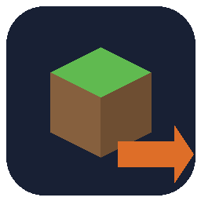
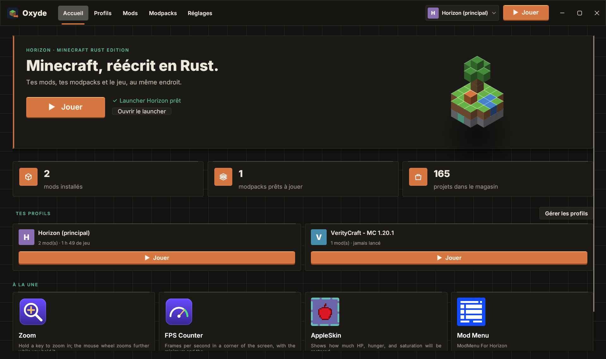
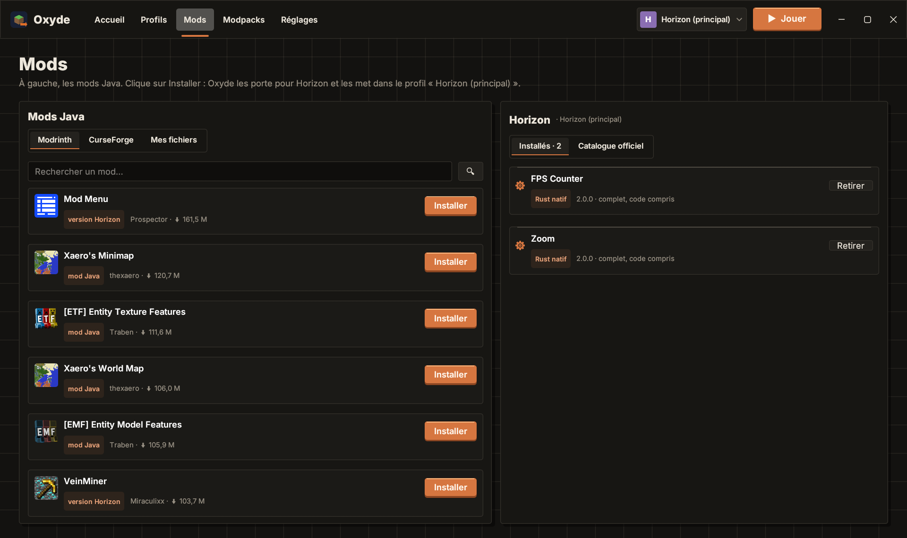
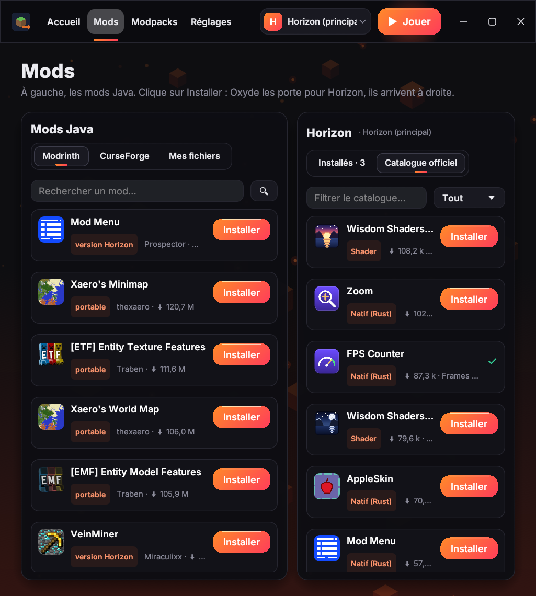
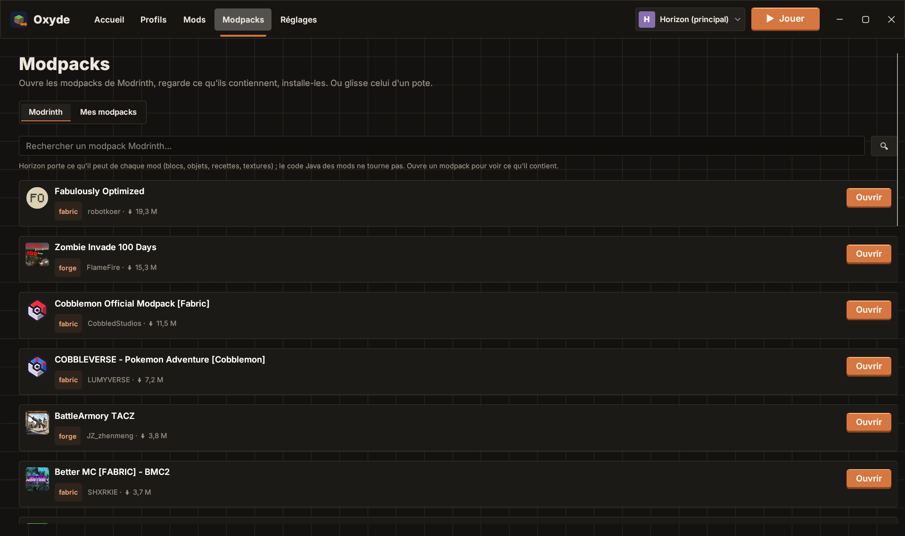
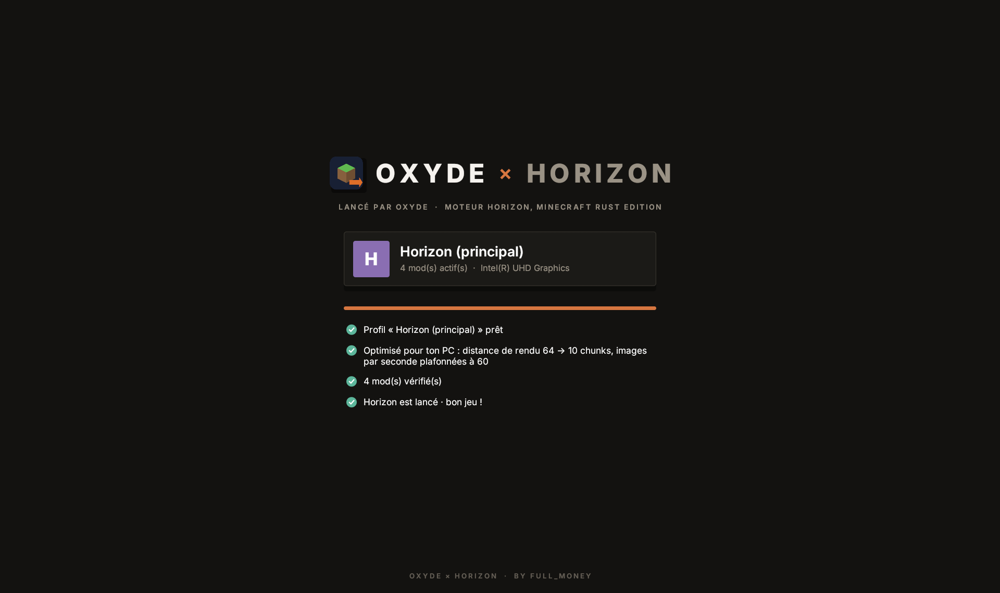
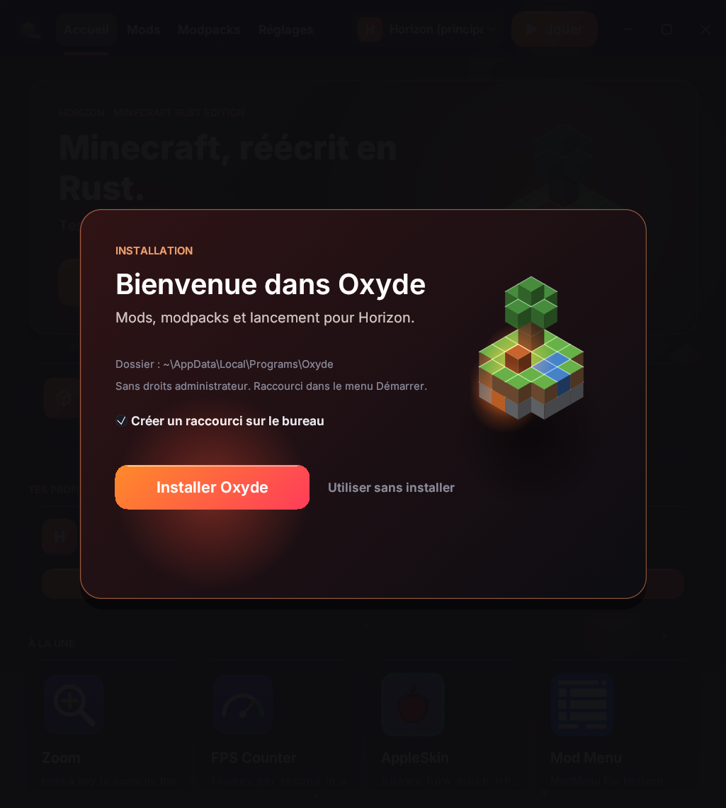
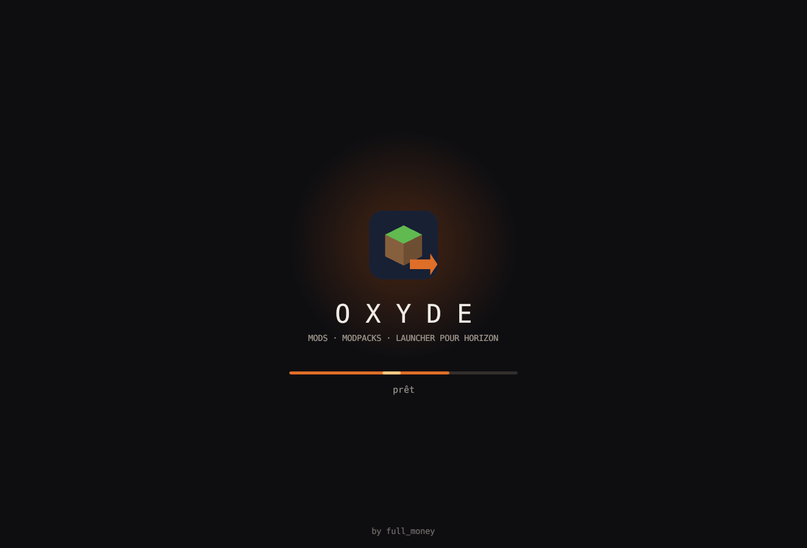

<p align="center">
  
</p>

<h1 align="center">Oxyde</h1>

<p align="center">
  <b>Mod store, Java mod porter, modpacks and launcher for <a href="https://playhorizon.dev/">Horizon</a></b><br>
  Horizon is Minecraft: Java Edition 26.3 rewritten in Rust (Minecraft Rust Edition).<br>
  Free · Open source (MIT) · One <code>.exe</code> · No install · by <b>full_money</b>
</p>

<p align="center">
  <a href="../../releases/latest"><b>⬇ Download Oxyde.exe</b></a>
</p>



## Features

- **Play**: one click starts Horizon with the selected profile, with a launch screen that shows each step.
- **Profiles**, like the Modrinth App: switch profile from the top bar, create new ones, each with its own mods.
  Ported modpacks show up as profiles too.
- **Mods, in two columns**:
  - on the left, **Java mods**: Modrinth, CurseForge (beta, needs your free CurseForge API key) and **My files**
    (any `.jar` you drop in the window);
  - on the right, **Horizon**: the mods of the selected profile, and Horizon's official catalogue (160+ projects).
  - **Install** moves a mod from left to right: Oxyde finds the best Horizon version of it (below) and installs it.
- **Modpacks in one click**: a friend sends you a modpack (`.oxypack`, `.mrpack` or a CurseForge `.zip`), you drop
  it in Oxyde, and everything is downloaded, ported and installed. Build your own `.oxypack` to share.
- **Live activity**: every install shows its progress and a detailed report (what was ported, what was left out).
- **Installer**: on first start Oxyde offers to install itself (no admin rights, Start menu and desktop shortcuts),
  and can uninstall itself from Settings.
- **Its own look**: custom window and title bar, Inter typeface, animated start-up and background.
- **Auto-update**: Oxyde updates itself from this repository's releases, after checking the SHA-256.

| Mods (Java on the left, Horizon on the right) | Horizon catalogue |
|---|---|
|  |  |

| Modpacks | Launch |
|---|---|
|  |  |

| Installer | Start-up |
|---|---|
|  |  |

## How a Java mod gets into Horizon

Horizon is a new program written in Rust: it **cannot run the Java code** of Forge, NeoForge, Fabric or Quilt mods
([Horizon docs](https://playhorizon.dev/docs/mods)). For every Java mod, Oxyde picks the best result available, in
this order:

1. **Official Horizon version.** Many mods have been rewritten in Rust for Horizon (AppleSkin, AE2, Zoom,
   Minimap…). Complete, code included. Installed from Horizon's registry.
2. **Official Horizon port.** When the Horizon launcher is installed, Oxyde hands the mod to Horizon's own porting
   pipeline (`horizon-launcher mods install`): blocks copy the closest vanilla block, recipes and loot tables are
   upgraded to 26.3, dependencies are installed too, and you get an exact report. Works for mods that have a 26.3
   version. A `.jar` from anywhere (CurseForge, an older version…) is matched by its fingerprint, or else by the
   name written inside it, so it can use this path too.
3. **Oxyde converter, as a last resort.** For older mods, Oxyde converts the content itself (textures, models,
   recipes, tags, loot, structures, blocks and items from a vanilla template). Marked "approximate".

Mods that are only code (Sodium, Fabric API, Iris…) are reported as such: there is nothing in them to port.
Tech mods keep their content (blocks, items, recipes) but not their machines or custom screens. Example: Sophisticated
Backpacks ports its 73 items, 6 blocks and textures, but its backpacks cannot be opened, because the backpack screen
and storage are Java code.

**Later: the Java bridge.** The Horizon team plans an optional Java bridge that will run unchanged Fabric 26.3
jars ([plan](https://github.com/horizon-rust/horizon/issues/13914)). It is not released yet.

## Modpacks

| You receive | What Oxyde does |
|---|---|
| `.oxypack` (Oxyde) | installs each listed mod with the steps above, into your main Horizon instance |
| `.mrpack` (Modrinth) or CurseForge `.zip` | imports and ports it with Horizon's launcher (`modpack import` + `modpack port`), as its own profile, listed under **Modpacks** with a Play button |
| `.hzmods` (Oxyde 1.x) | still supported |

The `.oxypack` format is a zip with `pack.json`:

```json
{
  "format": 2,
  "name": "My pack",
  "mods": [
    { "source": "horizon", "id": "zoom", "name": "Zoom" },
    { "source": "modrinth", "slug": "macaws-doors", "name": "Macaw's Doors" },
    { "source": "file", "id": "my_mod", "name": "My mod", "file": "mods/my_mod.hmod", "sha256": "…" }
  ]
}
```

Embedded files are checked against their SHA-256 before they are installed.

## How to use

1. Install [Horizon](https://playhorizon.dev/docs/install) and open its launcher once to sign in with your
   Microsoft account (you need to own Minecraft: Java Edition).
2. Download `Oxyde.exe` from [Releases](../../releases/latest) and run it.
3. **Store** → **Install**, or drop your `.jar` files / a modpack in the window.
4. Click **Play**.

Oxyde finds Horizon by itself: the launcher in `%LOCALAPPDATA%\Programs\Horizon Launcher`, and its profiles
(the main one is usually `%APPDATA%\horizon`). Oxyde installs itself in `%LOCALAPPDATA%\Programs\Oxyde`.

## Security

- The `.exe` is **built by GitHub Actions** from this source code ([workflow](.github/workflows/release.yml)),
  never on a personal computer.
- Each release publishes the **SHA-256** of the exe and a GitHub **build provenance attestation**:
  `gh attestation verify Oxyde.exe --repo 0full-money0/oxyde`
- No exe packer, no installer, no admin rights, no telemetry.
- Downloads only come from Horizon's registry, Modrinth's CDN, CurseForge's CDN (with your key) and this
  repository's releases, and are checked by hash where the source publishes one. Porting is done by Horizon's own
  launcher.

Windows SmartScreen may warn about a new unsigned exe: **More info → Run anyway**.

### Code signing policy

Free code signing provided by [SignPath.io](https://about.signpath.io/), certificate by
[SignPath Foundation](https://signpath.org/), once the project is accepted (the release workflow is ready for it).

- Committers and reviewers: the members of this repository with write access.
- Approvers: the repository owner (full_money).
- Only binaries built by this repository's GitHub Actions workflow from its public source are signed.
- Privacy: this program does not transfer any information to other networked systems unless specifically
  requested by the user. Automatic requests are limited to the update check (this repository's latest release)
  and the Horizon registry index. No personal data is sent.

## Command line

```bash
Oxyde.exe --install horizon <project-id>
Oxyde.exe --install modrinth <slug>
Oxyde.exe --install jar <file.jar>
Oxyde.exe --install pack <file.oxypack | file.mrpack | curseforge.zip>
Oxyde.exe --convert <output-folder> mod1.jar mod2.jar
```

## Build from source

```bash
cargo build --release
```

## Releasing a new version (maintainers)

1. Bump `version` in `Cargo.toml` and commit.
2. `git tag vX.Y.Z && git push origin main --tags`
3. GitHub builds and publishes the release. Installed copies offer the update on their next start.

## Credits and license

Made by **full_money**. Released under the [MIT License](LICENSE).

The Inter typeface (`assets/fonts`) is © The Inter Project Authors, under the SIL Open Font License 1.1
([license](assets/fonts/Inter-LICENSE.txt)).

Unofficial project, not affiliated with Mojang, Microsoft or the Horizon team. Ported and converted mods remain
under their authors' licenses: check them before sharing a modpack with embedded files.
